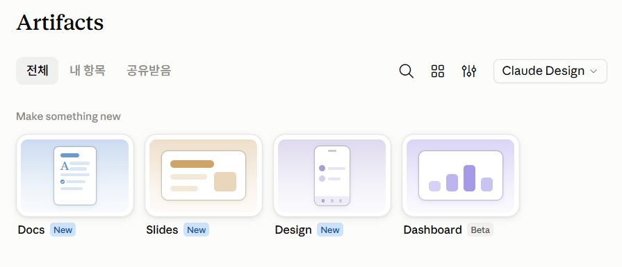

**1장 예제 안내 - 날씨/뉴스 API 이슈**

클로드 아티팩트의 외부 API 정책이 변경되어, 38페이지 예제에서 날씨와 뉴스를 불러올 수 없습니다. 해당 프롬프트를 아래와 같이 대체해 실행해 주세요.

> 오늘의 날짜와 시간, 검색창이 있는 나만의 시작 홈페이지를 만들고 싶어.

---

**[참조] 아티팩트 화면 변경 (2026년 10월, 모든 쇄 공통)**

얼마전 클로드 화면이 바뀌면서 책에 나온 [새 아티팩트] 버튼과 [처음부터 시작하기] 화면이 없어졌습니다. 지금은 왼쪽 사이드바에서 **[Artifacts(아티팩트)]** 를 누르면 "Make something new" 아래에 Docs, Slides, Design, Dashboard 카드가 보입니다.

  

여기서 **[Dashboard]** 를 누르고 위 프롬프트를 입력해 계속 진행해 주세요. 추가 질문에 답하면 첫 아티팩트가 완성되고, 바뀐 화면에서는 [게시] 버튼 대신 오른쪽 위의 **[공유]** 버튼으로 링크를 만들어 공유하시면 됩니다.
